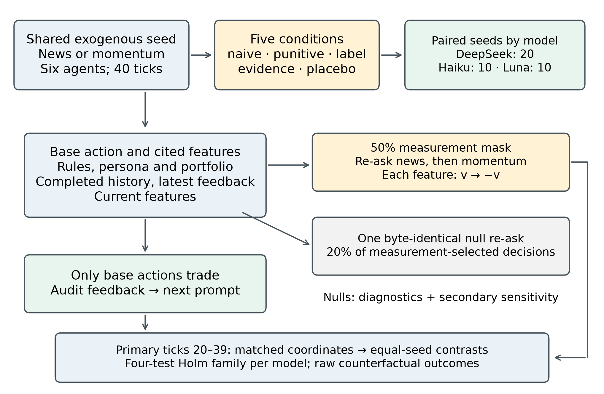

# Audit feedback and LLM agent decisions

Can an audit change an AI agent's decisions, or does it mainly change the reasons the agent gives? This preregistered study compares five audit conditions in a simulated trading market whose return driver switches between news and momentum. We reverse one input feature and ask for the decision again to measure behavioral sensitivity, then compare that sensitivity with the agent's stated reasons. Across a primary model and two replications, the results provide no corrected evidence for any predicted positive primary effect; agreement with an auditor does not establish that an explanation tracks the decision process.

**Study status:** Manuscript submitted to Future Internet (MDPI), 2026; preprint PDF in [paper/](paper/audit_feedback_llm_agents.pdf).



## Key findings

Numbers below are copied exactly from [confirmatory_results.md](results/confirmatory_results.md). DeepSeek is the primary model (20 paired seeds); Haiku and Luna are independent replications (10 paired seeds each). Each model has a separate four-test Holm family, with two-sided alpha 0.05. SCI is the treatment-minus-naive change in citation rate minus the corresponding change in decision dependence.

| Model / contrast | Estimate | Holm p | Interpretation |
|---|---:|---:|---|
| DeepSeek P1: evidence − naive precision | -0.0137 | 0.3683 | Inconclusive; predicted positive |
| DeepSeek P2: evidence − naive true-driver dependence | -0.0624 | 0.0140 | Negative, contrary to prediction |
| DeepSeek P3: label SCI, current true driver | -0.0389 | 0.2727 | Inconclusive; predicted positive |
| DeepSeek P4: placebo SCI, opposite current driver | -0.1341 | 4.179e-05 | Negative, contrary to prediction |
| Haiku replication (P1 / P2 / P3 / P4) | 0.0163 / -0.0059 / -0.0354 / -0.0572 | 1.0000 / 1.0000 / 0.7625 / 0.2666 | No Holm-significant primary contrast |
| Luna replication (P1 / P2 / P3 / P4) | -0.1198 / -0.0909 / -0.0333 / 0.0404 | 0.0007 / 0.0376 / 0.2883 / 0.2544 | Negative evidence effects on precision and true-driver dependence |

A negative significant contrast does not support its predicted positive direction. An inconclusive contrast does not establish equivalence or the absence of an effect. The placebo contrast estimates the complete feedback package; it does not isolate label falsity or identify deceptive intent.

## Preregistration and provenance

The six documents in [preregistration/](preregistration/) are byte-identical copies from the development repository: the plan, freeze marker, amendment evidence, calibration report, noise report, and research contract. The plan includes both amendments and recorded PI answers. Its SHA-256 is `dd8eaf872b37593433b3168725962937394d1b5d1c4ef005fe415534c37235a1`, matching `FROZEN.json`.

The frozen documents retain the internal project codenames **NS-B1/NS-B2**, historical workflow descriptions, original paths such as `docs/ns-b2/`, and historical DRAFT headings. `FROZEN.json`'s commit `72d05151df3fd1944fb009dda7506707ff455c82` refers to the **development repository**, whose history is deliberately absent here. The original manuscript PDF and the historical data-availability statement in its LaTeX source also retain development-repository references. This repository has a fresh public history; these historical identifiers are not public commit IDs.

The internal Python and data paths remain `src/v2` and `data/v2`. The legacy `ns-b2-analysis-v1` schema identifier, `nsb2:` cost-ledger tags, and optional `NS_B1_AUTH_JSON` environment variable remain for compatibility with recorded artifacts. These are the explained codename occurrences outside the frozen documents. The `v9` and `v10` figure directories contain only assets referenced by the current manuscript (plus the README design PNG); earlier manuscripts and their code/data are excluded.

Non-frozen copies have portable paths and public-facing documentation. The scientific analysis is unchanged; source checksums change because documentation and preregistration lookup paths change. The exploratory input ZIP is rebuilt from these public copies, with current checksums and a packaging notice in its manifest and adjacent provenance file. Its historical development-validation JSON is explicitly labeled as historical; the current release checks are in [VERIFICATION.md](VERIFICATION.md).

## Repository layout

```text
paper/                         Original v13 preprint PDF; compilable latex/main.tex
preregistration/               Six unchanged historical documents
results/                       Interpretive results and collection run log
src/v2/                        Simulation, prompts, attribution, clients and analyses
src/market.py                  Shared market dependency
tests/v2/                      Offline study tests using mock providers
data/v2/<model>/<stage>/       confirm, calib, noise, pilot and smoke records
data/v2/deepseek-v4-flash/
  noise_quarantine/            Excluded overlapping-run incident records
data/v2/analysis/confirm/      Recorded confirmatory JSON, report and figures
data/v2/analysis/
  confirm_exploratory_r12/     Explicitly exploratory analysis and input snapshot
data/v2/*ledger.jsonl          Cost accounting only
scripts/reproduce_analysis.py Temporary offline rebuild and strict comparison
```

## Reproduce the offline analysis

Use Python **3.12.2** on Linux, with CPU only. No API keys or model requests are needed. The pinned scientific dependencies match the recorded analysis environment; `statsmodels==0.15.0` is required for the secondary mixed models.

From the repository root:

```sh
python3 -m venv .venv
.venv/bin/python -m pip install -r requirements.txt
.venv/bin/python -m pytest tests/v2 -q
.venv/bin/python scripts/reproduce_analysis.py
```

The script reads all 200 completed confirmatory runs, verifies the freeze checksum, writes regenerated results, a report and figures into a temporary directory inside the repository, and compares them with `data/v2/analysis/confirm/results.json`. Every scientific value, data-selection record, and non-exempt metadata field must match exactly. Repository-root prefixes are normalized in paths; the execution timestamp, analysis-source checksum, and repository revision are reported separately because they describe the new execution and public packaging. The script removes its temporary output after comparison and leaves the committed results intact. `make reproduce` and `make test` run the same checks.

To deliberately regenerate the ordinary analysis output directory instead:

```sh
.venv/bin/python -m src.v2.analyze --stage confirm
```

This command overwrites the recorded generated output files and records the current execution provenance. Use the comparison script for routine verification.

To compile the paper, install a TeX Live distribution with `latexmk`, `pdflatex`, BibTeX and the packages requested by the bundled MDPI class, then run:

```sh
make paper
```

This builds `paper/latex/main.pdf`. The separately supplied `paper/audit_feedback_llm_agents.pdf` remains the original manuscript PDF; the public LaTeX copy has portable repository references and cleaned preparation prose.

## Rerunning collection

Supply provider keys through the environment variables `DEEPSEEK_API_KEY` and `OPENROUTER_API_KEY`. For example, Bash can read them without placing the key values in shell history:

```sh
read -rsp 'DeepSeek API key: ' DEEPSEEK_API_KEY; export DEEPSEEK_API_KEY
read -rsp 'OpenRouter API key: ' OPENROUTER_API_KEY; export OPENROUTER_API_KEY
.venv/bin/python -m src.v2.simulate --model deepseek-v4-flash --stage smoke --dry-run
```

For an optional external credential store, set `NS_B1_AUTH_JSON` to a file you manage outside the repository, with provider objects `deepseek` and `openrouter`, each containing a `key` field. There is no default credential-file path. Do not commit credential material.

For a new development collection, use a separate copy of the repository, archive/remove the existing run files in that copy so completed blocks are not skipped, and use the documented `--stage`, `--conditions` and `--seeds` options. A smoke collection after that preparation is:

```sh
.venv/bin/python -m src.v2.simulate --model deepseek-v4-flash --stage smoke --conditions naive --seeds 100
```

Real collection makes paid API requests; none are required for offline reproduction. Recorded confirm-stage costs from the run log were **USD 5.438 DeepSeek**, **USD 3.487 Haiku**, and **USD 2.033 Luna**. Cumulative provider costs at confirm completion, including development, were **USD 6.381 DeepSeek** and **USD 7.184 OpenRouter**; review costs are recorded separately in `review_ledger.jsonl`. The client enforces a cumulative USD 8 cap per provider. Preserve the existing ledgers: a new collection needs an explicit new budget, and historical prices are not a quote for future runs.

The confirm-stage freeze guard checks that the **development-repository commit** in `FROZEN.json` is an ancestor of the current revision. It intentionally refuses confirmation in this fresh public repository; the checksum and ancestor checks have not been bypassed. Rerunning collection is a **new study**, requiring a new preregistration, explicit budget and new freeze record in a separate study copy. Future provider outputs, aliases and service availability may differ.

## Limitations

This synthetic market and intervention-defined probe do not reveal internal reasoning or deceptive intent, and pooled instrument checks conceal regime differences; see the [paper's limitations and discussion](paper/audit_feedback_llm_agents.pdf).

## Citation

Jay, A., & Berlanga, R. (2026). *Audit Feedback, Decisions, and Explanations in LLM Trading Agents*. Manuscript submitted to *Future Internet* (MDPI). [Preprint PDF](paper/audit_feedback_llm_agents.pdf).

Machine-readable authorship, ORCIDs and repository metadata are in [CITATION.cff](CITATION.cff). No publication acceptance or DOI is claimed.

## Licenses

Code: [MIT](LICENSE), copyright 2026 Aldan Jay and Rafael Berlanga. Original data, preregistration, results and paper materials: [CC BY 4.0](LICENSE-DATA). Bundled third-party LaTeX templates and logos retain their own notices and terms.
