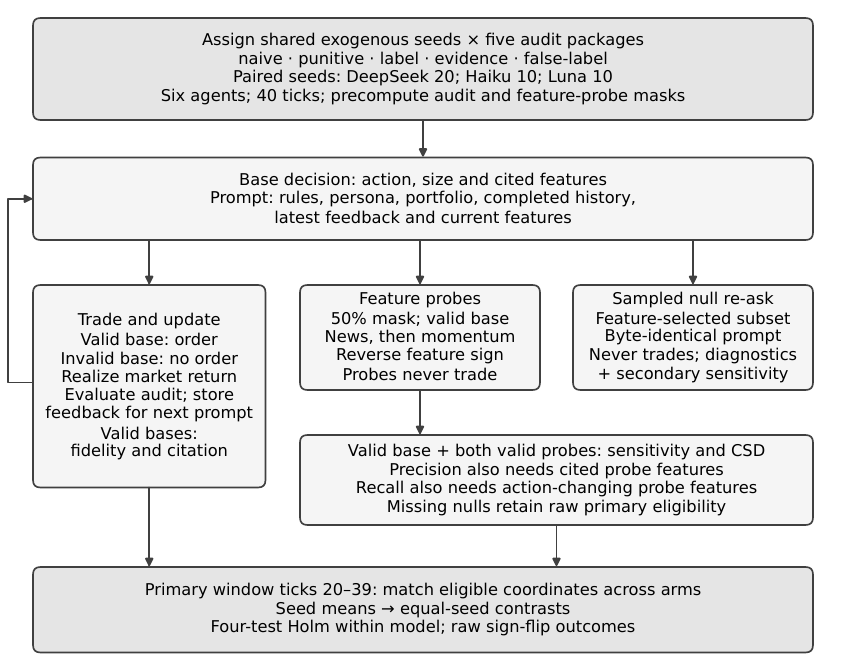

# Audit feedback and LLM agent decisions

Can audit feedback change what LLM trading agents cite and how they act? This preregistered study compares five feedback packages in a simulated market alternating news and momentum drivers. True-driver sign-flip sensitivity measures whether an action changes when the current driver's sign is reversed; citation–sensitivity difference (CSD) measures citation change minus sensitivity change relative to naive. Across a primary model and two replications, no corrected primary result supports its predicted positive direction. Failed news-regime discrimination for two models limits interpretation as driver use. The final paper also reports request, token and cost workload for a networked audit sidecar.

**Study status:** Submitted to Future Internet (MDPI), Special Issue 'Intelligent Agents and Their Application—2nd Edition', 2026; preprint PDF in [paper/](paper/audit_feedback_llm_agents.pdf).



## Key findings

Numbers below match the [final paper](paper/audit_feedback_llm_agents.pdf) and [confirmatory results](results/confirmatory_results.md). DeepSeek is primary (20 paired seeds); Haiku and Luna are independent replications (10 each). Each model has a separate four-test Holm family with two-sided alpha 0.05.

For traceability, CSD = the preregistration's SCI; false-label = its placebo condition.

| Model / contrast | Estimate | Holm p | Interpretation |
|---|---:|---:|---|
| DeepSeek P1: evidence − naive precision | -0.0137 | 0.3683 | Inconclusive; predicted positive |
| DeepSeek P2: evidence − naive true-driver sign-flip sensitivity | -0.0624 | 0.0140 | Negative, contrary to prediction |
| DeepSeek P3: label CSD, current true driver | -0.0389 | 0.2727 | Inconclusive; predicted positive |
| DeepSeek P4: false-label CSD, opposite current driver | -0.1341 | 4.179e-05 | Negative, contrary to prediction |
| Haiku replication (P1 / P2 / P3 / P4) | 0.0163 / -0.0059 / -0.0354 / -0.0572 | 1.0000 / 1.0000 / 0.7625 / 0.2666 | No Holm-significant primary contrast |
| Luna replication (P1 / P2 / P3 / P4) | -0.1198 / -0.0909 / -0.0333 / 0.0404 | 0.0007 / 0.0376 / 0.2883 / 0.2544 | Negative evidence effects on precision and true-driver sensitivity |

The DeepSeek false-label CSD result was not statistically confirmed in the replications' corrected tests. A negative significant contrast opposes its predicted positive direction; an inconclusive contrast does not establish equivalence. False-label combines a truth-based verdict and fine with a contradictory, persistent label: it estimates the complete assigned package, without isolating label falsity or deceptive intent.

The sign-flip instrument failed news-regime driver discrimination for DeepSeek and Haiku, despite passing the pooled true-driver sensitivity gate. At about half-decision probing, the networked audit-sidecar workload was 2.10 attempts per assigned decision for DeepSeek and 2.09 for each replication, with recorded costs per 1,000 assigned decisions of USD 0.23, 0.29 and 0.17. Latency was not recorded; these are workload measurements rather than deployed performance claims.

The implemented evidence tables used at most five completed ticks rather than the registered eight. Null re-ask sampling also departed from the registered full-mask recipe. See [implementation deviations](results/deviations.md); the original data and frozen documents are preserved.

## Preregistration and provenance

The six documents in [preregistration/](preregistration/) are byte-identical copies from the development repository: the plan, freeze marker, amendment evidence, calibration report, noise report, and research contract. The plan includes both amendments and recorded PI answers. Its SHA-256 is `dd8eaf872b37593433b3168725962937394d1b5d1c4ef005fe415534c37235a1`, matching `FROZEN.json`.

The frozen documents retain the internal project codenames **NS-B1/NS-B2**, historical workflow descriptions, original paths such as `docs/ns-b2/`, and historical DRAFT headings. `FROZEN.json`'s commit `72d05151df3fd1944fb009dda7506707ff455c82` refers to the **development repository**, whose history is deliberately absent here. This repository has a fresh public history; these historical identifiers are not public commit IDs.

The internal Python and data paths remain `src/v2` and `data/v2`. The legacy `ns-b2-analysis-v1` schema identifier, `nsb2:` cost-ledger tags, and optional `NS_B1_AUTH_JSON` environment variable remain for compatibility with recorded artifacts. These are the explained codename occurrences outside the frozen documents. The paper source includes only the two referenced figures, six generated table inputs, and the README design PNG. Historical machine-readable output keys retain their registered names for compatibility.

Non-frozen copies have portable paths and public-facing documentation. The scientific analysis is unchanged; source checksums change because documentation and preregistration lookup paths change. The exploratory input ZIP is rebuilt from these public copies, with current checksums and a packaging notice in its manifest and adjacent provenance file. Its historical development-validation JSON is explicitly labeled as historical; the current release checks are in [VERIFICATION.md](VERIFICATION.md).

## Repository layout

```text
paper/                         Final 15-page PDF
paper/latex/                   Compilable main.tex, sources and four offline scripts
paper/latex/figures/            Two referenced PDFs and README design PNG
paper/latex/tables/             Six generated manuscript table inputs
preregistration/               Six unchanged historical documents
results/                       Confirmatory results, collection log and deviations
src/v2/                        Simulation, prompts, clients, confirmatory and exploratory analyses
src/market.py                  Shared market dependency
tests/v2/                      Offline study tests using mock providers
data/v2/<model>/<stage>/       confirm, calib, noise, pilot and smoke records
data/v2/deepseek-v4-flash/
  noise_quarantine/            Excluded overlapping-run incident records
data/v2/analysis/confirm/      Recorded confirmatory JSON, report and figures
data/v2/analysis/exploratory/  Final-paper diagnostics, prompts and workload summaries
data/v2/analysis/
  confirm_exploratory_r12/     Explicitly exploratory analysis and input snapshot
data/v2/*ledger.jsonl          Cost accounting only
scripts/reproduce_analysis.py Temporary offline rebuild and strict comparison
```

## Reproduce the offline analysis

Use Python **3.12.2** on Linux, with CPU only. No API keys or model requests are needed. The pinned scientific dependencies match the recorded analysis environment; `statsmodels==0.15.0` is required for the secondary mixed models.

From the repository root:

```sh
python3 -m venv .venv
.venv/bin/python -m pip install -r requirements.txt
.venv/bin/python -m pytest -q
.venv/bin/python scripts/reproduce_analysis.py
```

The script reads all 200 completed confirmatory runs, verifies the freeze checksum, writes regenerated results, a report and figures into a temporary directory inside the repository, and compares them with `data/v2/analysis/confirm/results.json`. Every scientific value, data-selection record, and non-exempt metadata field must match exactly. Repository-root prefixes are normalized in paths; the execution timestamp, analysis-source checksum, and repository revision are reported separately because they describe the new execution and public packaging. The script removes its temporary output after comparison and leaves the committed results intact. `make reproduce` and `make test` run the same checks.

To deliberately regenerate the ordinary analysis output directory instead:

```sh
.venv/bin/python -m src.v2.analyze --stage confirm
```

This command overwrites the recorded generated output files and records the current execution provenance. Use the comparison script for routine verification.

To regenerate the final paper's exploratory analyses and supporting inputs, without any provider requests:

```sh
.venv/bin/python -m pytest -q tests/v2/test_exploratory_analyses.py
.venv/bin/python src/v2/exploratory_analyses.py
.venv/bin/python paper/latex/summarize_audit_traffic.py
.venv/bin/python paper/latex/analyze_label_punitive.py
.venv/bin/python paper/latex/generate_tables.py
.venv/bin/python paper/latex/generate_figures.py
pdftoppm -png -singlefile -r 150 paper/latex/figures/fig1_design.pdf paper/latex/figures/fig1_design
```

These commands overwrite generated exploratory artifacts and manuscript inputs. The exploratory analysis asserts exact reproduction of every primary contrast and registered secondary value. With the pinned environment, repeated public regeneration of `results.json` is byte-identical; its source/path provenance describes the public packaging. Historical development commits remain provenance identifiers, independently of public Git history. Scientific estimates are unchanged from the final-paper inputs.

To compile the paper, install TeX Live with `latexmk`, `pdflatex`, BibTeX and the packages requested by the bundled MDPI class, then run:

```sh
make paper
```

This builds `paper/latex/main.pdf`: **15 pages**, including references and back matter, with no undefined references or overfull boxes. The supplied `paper/audit_feedback_llm_agents.pdf` is the final manuscript PDF, and the bundled source, figures and tables reproduce its contents. Detailed secondary and exploratory outputs are in [results/](results/) and [data/v2/analysis/exploratory/](data/v2/analysis/exploratory/). Current release checks are in [VERIFICATION.md](VERIFICATION.md).

## Rerunning collection

Supply provider keys through the environment variables `DEEPSEEK_API_KEY` and `OPENROUTER_API_KEY`. For example, Bash can read them without placing the key values in shell history:

```sh
read -rsp 'DeepSeek API key: ' DEEPSEEK_API_KEY; export DEEPSEEK_API_KEY
read -rsp 'OpenRouter API key: ' OPENROUTER_API_KEY; export OPENROUTER_API_KEY
.venv/bin/python -m src.v2.simulate --model deepseek-v4-flash --stage smoke --dry-run
```

For an optional external credential store, set `NS_B1_AUTH_JSON` to a file you manage outside the repository, with provider objects `deepseek` and `openrouter`, each containing a `key` field. There is no default credential-file path. Do not commit credential material.

For a new development collection, use a separate copy of the repository, archive/remove the existing run files in that copy so completed blocks are not skipped, and use the documented `--stage`, `--conditions` and `--seeds` options. A smoke collection after that preparation is:

```sh
.venv/bin/python -m src.v2.simulate --model deepseek-v4-flash --stage smoke --conditions naive --seeds 100
```

Real collection makes paid API requests; none are required for offline reproduction. Recorded confirm-stage costs from the run log were **USD 5.438 DeepSeek**, **USD 3.487 Haiku**, and **USD 2.033 Luna**. Cumulative provider costs at confirm completion, including development, were **USD 6.381 DeepSeek** and **USD 7.184 OpenRouter**; review costs are recorded separately in `review_ledger.jsonl`. The client enforces a cumulative USD 8 cap per provider. Preserve the existing ledgers: a new collection needs an explicit new budget, and historical prices are not a quote for future runs.

The confirm-stage freeze guard checks that the **development-repository commit** in `FROZEN.json` is an ancestor of the current revision. It intentionally refuses confirmation in this fresh public repository; the checksum and ancestor checks have not been bypassed. Rerunning collection is a **new study**, requiring a new preregistration, explicit budget and new freeze record in a separate study copy. Future provider outputs, aliases and service availability may differ.

## Limitations

This synthetic market and intervention-defined probe do not reveal internal reasoning or deceptive intent, and pooled instrument checks conceal regime differences; see the [paper's limitations and discussion](paper/audit_feedback_llm_agents.pdf).

## Citation

Jay, A., & Berlanga, R. (2026). *Audit Feedback, Decisions, and Explanations in LLM Trading Agents*. Manuscript submitted to *Future Internet* (MDPI). [Preprint PDF](paper/audit_feedback_llm_agents.pdf).

Machine-readable authorship, ORCIDs and repository metadata are in [CITATION.cff](CITATION.cff). No publication acceptance or DOI is claimed.

## Licenses

Code: [MIT](LICENSE), copyright 2026 Aldan Jay and Rafael Berlanga. Original data, preregistration, results and paper materials: [CC BY 4.0](LICENSE-DATA). Bundled third-party LaTeX templates and logos retain their own notices and terms.
